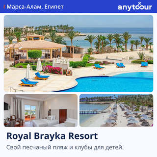
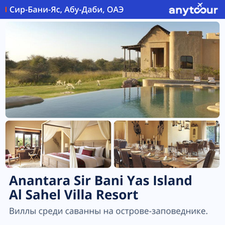

# AnyTour Satori — комплект для CONTENT

**Выбранная композиция сохранена.** Павел сообщил о дополнительном просмотре Royal Brayka, Al Sahel и Koh Yao Yai: обязательных исправлений композиции нет. Ни один из этих образцов и готовый набор из 11 карточек здесь не изменён. В этот комплект скопированы исходные PNG шириной 320 px; их хеши и хеши полных изображений 1000×1000 записаны в [review/manifest.json](review/manifest.json).

Владелец остаётся [CONTENT / #1566](https://github.com/pyatkoff/max-search-bot/issues/1566#issuecomment-6961029169). Сообщение пользователя подтверждает выбранное направление; отдельная формальная приёмка шрифта и редакционных формулировок в координации не найдена. Этот документ не вводит нового владельца, очереди или разрешения на выпуск.

## Три контрольных образца

### Royal Brayka Resort · Tourvisor 4185

Короткое название и горизонтальная фотография. **На показанном образце — новая редакционная кандидатура**, «Свой песчаный пляж и клубы для детей.». Она не объявляется принятой подписью рабочего каталога. Прежняя строка пилота, «Семейный отдых у песчаного пляжа.», сохранена отдельно в исходном пакете; там же есть новая композиция с прежним текстом для чистого сравнения. Основание кандидатуры — [официальный обзор отеля](https://braykaresorts.com/royal-brayka-resort/overview), прочитанный в пилоте; это не новое разрешение публикации.

### Anantara Sir Bani Yas Island Al Sahel Villa Resort · Tourvisor 27481

Полное длинное название и осмысленный перенос. Подпись «Виллы среди саванны на острове-заповеднике.» и фотографии сохранены из пилота. Новых редакционных формулировок для этого примера не предложено.

### Anantara Koh Yao Yai Resort & Villas · Tourvisor 88169

Вертикальная главная фотография, сохранённые корпус и пляж. Исходная подпись на образце не менялась: «Семейные люксы и виллы с собственным бассейном.». Перед коммерческим использованием требуется снять возможное прочтение о собственном бассейне у семейных люксов; отдельная кандидатура приведена ниже.

## Точный остаток для приёмки

| Вопрос | Конкретное решение CONTENT |
| --- | --- |
| Шрифт | Принять временный **Open Sans** для этого режима либо предоставить разрешённый Aeroport и повторить проверку трёх образцов. Самовольной смены шрифта в PR нет. |
| Royal Brayka: текст | Явно выбрать прежнюю строку «Семейный отдых у песчаного пляжа.» или новую кандидатуру «Свой песчаный пляж и клубы для детей.». Выбор фиксируется в редакционном входе, а не внутри рендера. |
| Koh Yao Yai: область утверждения | Проверить категории по принятому источнику и отдельно рассмотреть пунктуационный вариант **«Семейные люксы. Виллы с собственным бассейном.»**. В замороженном наборе это изменение не выполнено; бассейн семейным люксам не приписывается автоматически. |
| Первый коммерческий вход | Обычным порядком CONTENT принять точную запись, подпись и выбранные фотографии с их правами и идентификаторами. Прежние `sourceRefs`, ограничения и holds сохраняются. Наличие файла или его официального URL не означает открытую лицензию. |

Эти вопросы не требуют повторного исследования Satori. Приёмка конкретного коммерческого входа не подменяет обязательные технические проверки и обычный допуск выпуска.

## Сохранённый набор и доказательства

- [Все 11 карточек и сравнение при 320/360 px](https://chatgpt.com/library?file_id=libfile_fde3_f-dc28799db2808191bcdb7150cd3d4de1_839482358a3c8191a38d8cf811d28df4&account_id=personal).
- [Архив готовых 11 карточек](https://chatgpt.com/library?file_id=libfile_fde3_f-74a2822f7594819180972d30ba44eae7_839482358a3c8191a38d8cf811d28df4&account_id=personal).
- [Полный исходный пакет, входные данные и прежние сравнения](https://chatgpt.com/library?file_id=libfile_fde3_f-4a2b2ed6fb6c8191b705d761cb51da35_839482358a3c8191a38d8cf811d28df4&account_id=personal).
- [Отчёт о завершённой визуальной итерации](https://chatgpt.com/library?file_id=libfile_fde3_f-4773d7b8a3208191bbf2478f1b50a5f5_839482358a3c8191a38d8cf811d28df4&account_id=personal).

Ссылки используют существующий доступ владельца; этот PR не меняет права доступа. Полный пакет сохранён отдельно, чтобы не добавлять исследовательский архив в Git. Его SHA256: `1bf1540aa32d03ce797617d4681e4c671003b64c42a2eb27f0113e4159bd1f67`.

## Состояние этапа

Исследовательский эксперимент завершён. Композиция выбрана, пакет подготовлен для технического чернового PR; новые дизайн-эксперименты не требуются. Принятие в рабочий код, установка и результат в каналах этим комплектом **не подтверждаются**. Физический телефон и компрессия каналами ранее не проверялись. Публикации, фиды, расписания и сервер не меняются; Pillow остаётся вариантом по умолчанию.
